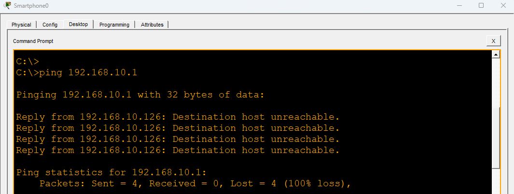
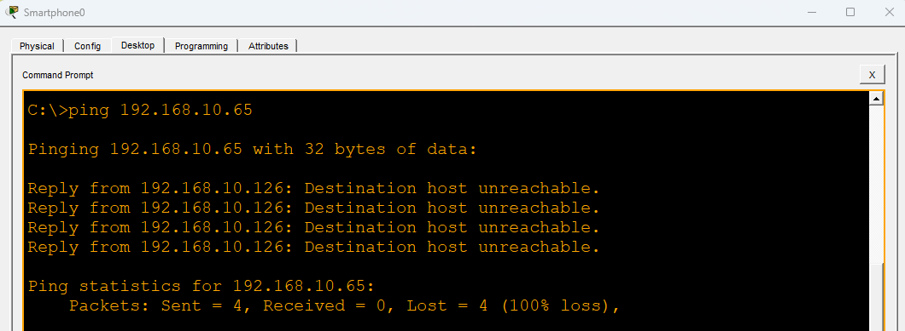
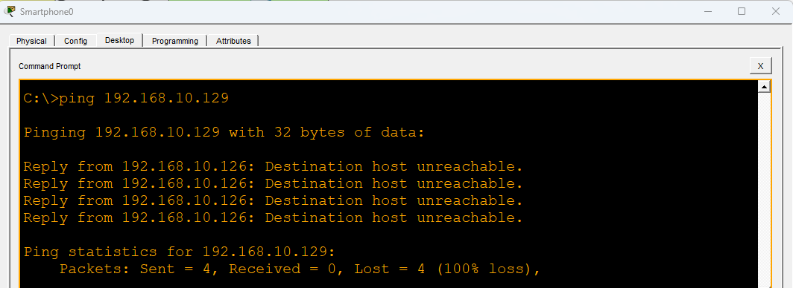
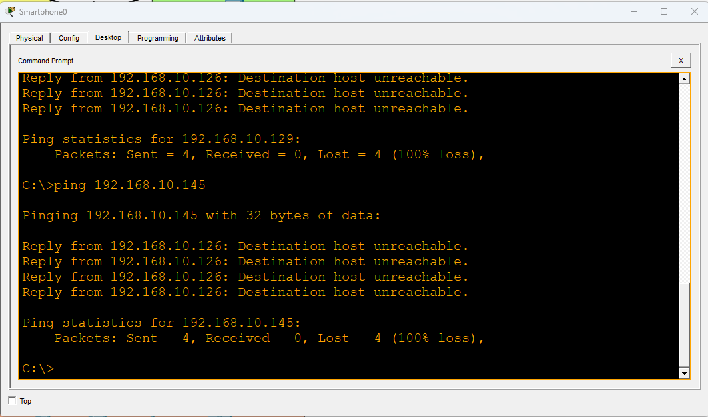
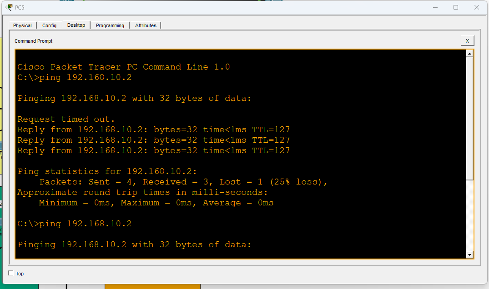
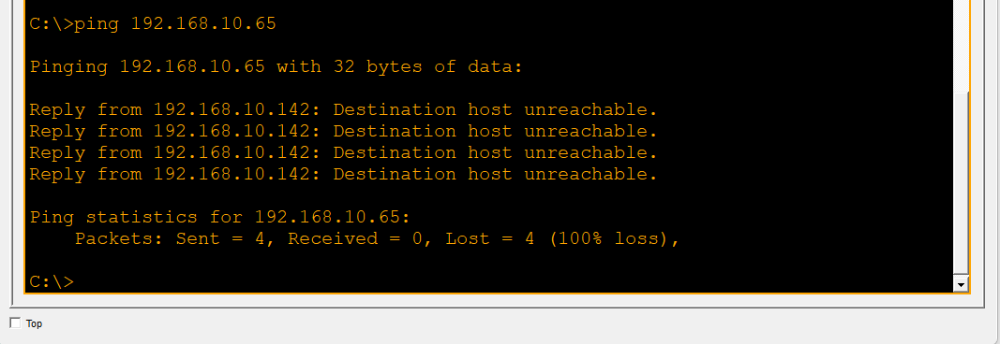

# PT Nusantara Agro — Multi-VLAN Network with ACL Isolation

Studi kasus simulasi jaringan kantor tunggal multi-divisi menggunakan Cisco Packet Tracer. Mencakup VLSM subnetting, VLAN trunking, inter-VLAN routing dengan multilayer switch (SVI), serta isolasi antar-VLAN menggunakan Extended ACL.

## 📌 Latar Belakang

PT Nusantara Agro adalah perusahaan agribisnis dengan 1 kantor pusat di Makassar yang memiliki 4 divisi berbeda plus jaringan Guest WiFi. Kebutuhan utama: jaringan tersegmentasi per divisi dengan kontrol akses antar-VLAN yang ketat, serta koneksi ke luar jaringan (internet/WAN) melalui router.

## 🗺️ Topologi

- **1x Multilayer Switch** (core/distribution) — melakukan inter-VLAN routing menggunakan SVI (bukan Router-on-a-Stick)
- **2x Access Switch** — menghubungkan device tiap divisi ke core, menggunakan trunking
- **1x Router** — gateway ke luar jaringan (internet/WAN simulasi), menggunakan static/default route
- **1x Access Point** — khusus untuk Guest WiFi (VLAN 99), autentikasi WPA2-PSK


## 📊 VLAN & Subnetting (VLSM dari 192.168.10.0/24)

| VLAN | Nama      | Jumlah Host | Network Address | Broadcast Address | Netmask          | Last Usable Address |
|------|-----------|-------------|------------------|--------------------|------------------|-----------------------|
| 10   | Manajemen | 10 Host     | 192.168.10.144   | 192.168.10.159     | 255.255.255.240  | 192.168.10.158         |
| 20   | Keuangan  | 25 Host     | 192.168.10.64    | 192.168.10.95      | 255.255.255.224  | 192.168.10.94          |
| 30   | Produksi  | 50 Host     | 192.168.10.0     | 192.168.10.63      | 255.255.255.192  | 192.168.10.62          |
| 40   | Gudang    | 12 Host     | 192.168.10.128   | 192.168.10.143     | 255.255.255.240  | 192.168.10.142         |
| 99   | Guest WiFi| 15 Host     | 192.168.10.96    | 192.168.10.127     | 255.255.255.224  | 192.168.10.126         |

Link antara Multilayer Switch dan Router: `192.168.10.160/30`

## 🔒 Access Control Policy

| Dari VLAN       | Boleh ke                     | Diblok dari                      |
|-----------------|-------------------------------|------------------------------------|
| Gudang (40)     | Produksi (30), Internet       | Keuangan (20), Manajemen (10)      |
| Guest WiFi (99) | Internet saja                 | Semua VLAN internal (10, 20, 30, 40) |

Diimplementasikan menggunakan **Extended ACL** yang diterapkan pada interface SVI (arah `in`). Detail konfigurasi ada di `configs/multilayer-switch.txt`.

## 🔐 Keamanan Tambahan

- Native VLAN pada semua trunk diubah ke VLAN 999 (tidak dipakai untuk data) sebagai mitigasi VLAN hopping
- VLAN manajemen switch terpisah dari VLAN 1 default
- Guest WiFi menggunakan autentikasi WPA2-PSK/AES

## ✅ Hasil Verifikasi

| Test | Sumber | Tujuan | Hasil |
|------|--------|--------|-------|
| 1 | PC Guest WiFi | PC Produksi | ❌ Unreachable (sesuai desain) |
| 2 | PC Guest WiFi | PC Keuangan | ❌ Unreachable (sesuai desain) |
| 3 | PC Guest WiFi | PC Manajemen | ❌ Unreachable (sesuai desain) |
| 4 | PC Guest WiFi | PC Gudang | ❌ Unreachable (sesuai desain) |
| 5 | PC Guest WiFi | Sesama VLAN Guest | ✅ Sukses |
| 6 | PC Gudang | Router (link WAN) | ✅ Sukses |
| 7 | PC Gudang | PC Produksi | ✅ Sukses |
| 8 | PC Gudang | PC Keuangan | ❌ Unreachable (sesuai desain) |
| 9 | PC Gudang | PC Manajemen | ❌ Unreachable (sesuai desain) |

Semua hasil sesuai dengan access control policy yang dirancang.

### Screenshot Bukti Testing

**Guest WiFi → semua VLAN internal (harus diblok):**






**Gudang → Produksi (harus sukses):**



**Gudang → Keuangan (harus diblok):**



## 📁 Isi Repo

```
pt-nusantara-agro/
├── README.md
├── vlsm-table.png
├── images/
│   └── Screenshot 2026-10-29 231346.png
├── configs/
│   ├── multilayer-switch.txt
│   ├── access-switch1.txt
│   └── access-switch2.txt
└── screenshot/
    ├── ping-test-guest-wifi1.png
    ├── ping-test-guest-wifi2.png
    ├── ping-test-guest-wifi3.png
    ├── ping-test-guest-wifi4.png
    ├── ping-gudang-to-produksi.png
    └── ping-gudang-to-keuangan.png
```

## 🛠️ Tools

- Cisco Packet Tracer
